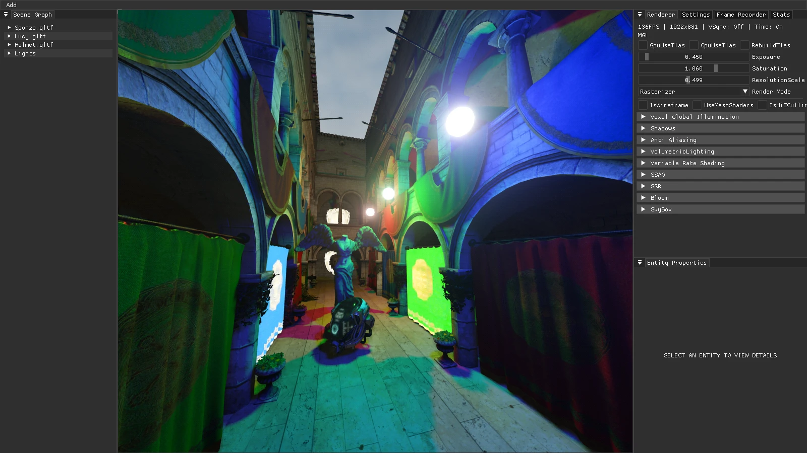

<p align="center">
  
</p>

<h3 align="center">OpenGL 4.6 on Apple silicon, running on Metal</h3>

<p align="center">
  <a href="https://github.com/BryanHaley/MGL/releases/latest"></a>
  
  
  <a href="LICENSE"></a>
</p>

OpenGL has been deprecated for years on macOS, and was never updated past 4.1. MooGL is a complete
OpenGL 4.6 Core implementation written on top of Metal, so modern GL code (compute shaders,
direct state access, SPIR-V, bindless textures, mesh shaders) builds and runs on a Mac. You link it like any other library and open a window with the GLFW or SDL2 it ships with.

It also ships AMD FSR 2's API on top of Apple's MetalFX upscaler so a game that uses
FSR 2 on Windows/Linux can be ported to Mac without touching its FSR 2 code.

## Where it stands

| Suite | Passed | Failed |
| --- | ---: | ---: |
| Khronos KHR-GL46 (the OpenGL 4.6 conformance tests) | 17,482 | **0** |
| Khronos KHR-Single | 8,836 | **0** |
| Khronos `texture_swizzle` | 505 | **0** |
| MooGL's own suite | 1,369 | **0** |

The 1,536 KHR-GL46 cases MooGL does not run are ones the conformance suite lets a driver
decline (mostly optional extensions). These are local runs; MooGL has not been submitted to Khronos and is not an officially conformant product.

## IDKEngine on MooGL

<p align="center">
  
</p>

[IDKEngine](https://github.com/BoyBaykiller/IDKEngine) has an OpenGL 4.6 renderer written
for NVIDIA hardware on Windows. Here it runs through MooGL on an M1 Max MacBook Pro,
drawing 1600×900 pixels at about 130 fps. The frame shows:

- **Sponza, Lucy and the damaged helmet**, about 290,000 triangles, drawn with
  multi-draw-indirect: one draw call for the whole scene.
- **Bindless textures**: every material reads its textures through handles stored in buffers,
  not through texture units.
- **Coloured point lights with soft shadows**, each light's cube map rendered in one pass by
  writing `gl_Layer` from the vertex shader (`ARB_shader_viewport_layer_array`).
- **SSAO, volumetric light and bloom**, all compute shaders, then tone mapping.
- **FSR 2 upscaling** from half resolution, through MooGL's FSR 2 on MetalFX.
- The engine's **ImGui** interface, drawn through the same GL context. At the top right it
  reports `MGL` as the renderer and a resolution scale of 0.5.

MooGL's build of the engine also turns on its subgroup, SPIR-V, debug-output and mesh shader
paths, which stock macOS can't run, and its path tracer works too.

## Get the SDK

Download `MooGL-SDK-<version>-macos-arm64.tar.gz` from the
[releases page](https://github.com/BryanHaley/MGL/releases) and unpack it anywhere.

```
MooGL-SDK/
  lib/        libmoogl.dylib (OpenGL)
              libglfw.dylib  libSDL2-2.0.0.dylib (GLFW and SDL2 for MooGL)
              libffx_fsr2_api.dylib (FSR 2 on MetalFX)
              cmake/MooGL/  cmake/SDL2/
  include/    GL/glcorearb.h  KHR/khrplatform.h  GLFW/  SDL2/  MGLContext.h  ffx-fsr2/
  examples/   triangle/ (GLFW)  sdl2_triangle/ (SDL2)
  nuget/      FFX_FSR2 for C# on macOS
  licenses/
```

The libraries are signed and notarized, so macOS loads them straight from the download.

You need an Apple silicon Mac on macOS 13 or later, plus Xcode or the Command Line Tools
(`xcode-select --install`). MooGL is tested on macOS 27.

## Build your first program

The SDK's example draws a spinning triangle. With CMake:

```bash
cd MooGL-SDK-*/examples/triangle
cmake -B build -DCMAKE_PREFIX_PATH="$PWD/../.."
cmake --build build
./build/triangle
```

Or with nothing but clang:

```bash
SDK=/path/to/MooGL-SDK
clang main.c -o triangle -I"$SDK/include" -L"$SDK/lib" -lglfw -lmoogl -Wl,-rpath,"$SDK/lib"
```

In your own CMake project:

```cmake
find_package(MooGL REQUIRED)                        # with -DCMAKE_PREFIX_PATH=/path/to/MooGL-SDK
target_link_libraries(my_app PRIVATE MooGL::glfw)   # GLFW and OpenGL
```

`MooGL::GL` is the GL library alone and `MooGL::FSR2` is FSR 2. `MooGL_LIBRARY_DIR` holds
the folder with the dylibs.

## Writing OpenGL 4.6 on a Mac

Everything below is ordinary OpenGL. These are the few places where a Mac or MooGL needs
something specific.

### 1. Open a window with GLFW or SDL2

Use the `libglfw` or `libSDL2` from the SDK, not one from Homebrew: they are GLFW 3.4 and
SDL 2.32 with a backend that creates MooGL contexts instead of Apple's. Any version request up
to 4.6 gets a 4.6 core context, so code that asks for 3.3 or 4.1 core, as most Mac code does,
works unchanged. With GLFW:

```c
#include <GL/glcorearb.h>
#define GLFW_INCLUDE_NONE
#include <GLFW/glfw3.h>

glfwInit();
glfwWindowHint(GLFW_CONTEXT_VERSION_MAJOR, 4);
glfwWindowHint(GLFW_CONTEXT_VERSION_MINOR, 6);
glfwWindowHint(GLFW_OPENGL_PROFILE, GLFW_OPENGL_CORE_PROFILE);
GLFWwindow *window = glfwCreateWindow(1280, 720, "My app", NULL, NULL);
glfwMakeContextCurrent(window);
```

`GLFW_OPENGL_DEBUG_CONTEXT` and `GLFW_CONTEXT_NO_ERROR` work as usual. With SDL2:

```c
#include <GL/glcorearb.h>
#include <SDL2/SDL.h>

SDL_Init(SDL_INIT_VIDEO);
SDL_GL_SetAttribute(SDL_GL_CONTEXT_MAJOR_VERSION, 4);
SDL_GL_SetAttribute(SDL_GL_CONTEXT_MINOR_VERSION, 6);
SDL_GL_SetAttribute(SDL_GL_CONTEXT_PROFILE_MASK, SDL_GL_CONTEXT_PROFILE_CORE);
SDL_Window *window = SDL_CreateWindow("My app", SDL_WINDOWPOS_CENTERED, SDL_WINDOWPOS_CENTERED,
                                      1280, 720, SDL_WINDOW_OPENGL | SDL_WINDOW_ALLOW_HIGHDPI);
SDL_GLContext context = SDL_GL_CreateContext(window);
```

Link it with `find_package(SDL2)` and `SDL2::SDL2` plus `MooGL::GL`, or `-lSDL2 -lmoogl`. SDL2's
debug and no-error flags work too. A few things differ from Apple's driver:

- A MooGL context draws into the window it was created for, and can't be made current on another.
- Contexts can't share objects yet, so a share request fails: `SDL_GL_SHARE_WITH_CURRENT_CONTEXT`
  in SDL2, a share window in GLFW. Sharing is on the roadmap.
- `SDL_Renderer` has no `opengl` backend, which needs legacy GL. It uses Metal, its default on
  macOS anyway.

OpenGL ES contexts aren't offered yet; they're on the roadmap.

### 2. Call GL functions

Pick one:

- **Call them directly.** `libmoogl` exports every GL 4.6 function, and MooGL's
  `GL/glcorearb.h` declares them all. Link `-lmoogl`, as the example does.
- **Use a loader** such as glad, GLEW or epoxy, passing it `glfwGetProcAddress`. Functions
  MooGL doesn't have come back as `NULL`, as on any driver. Code that already uses a loader
  needs no changes.

**Don't include `<OpenGL/gl3.h>` or link `-framework OpenGL` yourself. That is Apple's 4.1
driver, and GL calls bound to it never reach MooGL.**

### 3. Shaders

Write `#version 460 core` GLSL, or pass SPIR-V with `glShaderBinary` and `glSpecializeShader`
(`ARB_gl_spirv`). MooGL compiles GLSL to SPIR-V with glslang, then SPIR-V to Metal with
SPIRV-Cross, so compile and link errors read like glslang's. The first link of each program
costs a Metal compile, so link your programs at load time, not mid-frame.

### 4. Draw at the right size

On a Retina screen the framebuffer has more pixels than the window has points. Size your
viewport and render targets from `glfwGetFramebufferSize` or `SDL_GL_GetDrawableSize`, not the
window size. GLFW draws at Retina resolution unless `GLFW_COCOA_RETINA_FRAMEBUFFER` is off; SDL2
only does with `SDL_WINDOW_ALLOW_HIGHDPI`. A new context's viewport already covers the whole
framebuffer.

### 5. Present

`glfwSwapBuffers` or `SDL_GL_SwapWindow` shows the frame. A swap interval of 1 paces it to the
display, and 0 runs as fast as the GPU will go.

### 6. Debug

- `KHR_debug` works: `glDebugMessageCallback`, object labels and debug groups. Debug groups
  and labels show up in Xcode's Metal GPU capture, which is the best way to look inside a frame.
- `MGL_LOG_LEVEL=2` (or `3`) prints what MooGL is doing to stderr.
- `MGL_DEBUG_MSL=1` prints the Metal shader each GL shader turned into.
- `MGL_DEBUG_CONTEXT=1` prints every function a loader asked for that MooGL lacks.

### 7. Ship it in an app bundle

Copy the dylibs into your app and point the executable at them:

```
MyApp.app/Contents/MacOS/MyApp
MyApp.app/Contents/Frameworks/libmoogl.dylib
MyApp.app/Contents/Frameworks/libglfw.dylib        (or libSDL2-2.0.0.dylib)
```

```bash
clang ... -Wl,-rpath,@executable_path/../Frameworks
codesign --force --timestamp --options runtime --sign "Developer ID Application: ..." \
    MyApp.app/Contents/Frameworks/*.dylib MyApp.app
```

Sign the copied dylibs with your own identity, as above: an app with the hardened runtime only
loads libraries signed by its own team. Every library is arm64 only. MooGL's libraries refer to
each other through `@rpath`, so they just need to sit in the same folder.

### Other languages and engines

Most bindings load GLFW or SDL2 as a dylib and get GL functions through it: OpenTK and
SDL2-CS in C#, LWJGL in Java, pyGLFW and PySDL2 in Python, and others. Put the SDK's
`libglfw.dylib` (as `libglfw.3.dylib`) or `libSDL2-2.0.0.dylib`, plus `libmoogl.dylib`, where the
binding looks for them, and it runs on MooGL. That's how IDKEngine runs above. Use only one copy
of `libmoogl.dylib` per process.

SDL3, SFML 2.6 and 3, raylib and GLUT are on the roadmap.

## FSR 2 on MetalFX

`libffx_fsr2_api.dylib` implements all 14 functions of AMD's FSR 2 OpenGL API, using
[AMD's headers](https://github.com/JuanDiegoMontoya/FidelityFX-FSR2-OpenGL) unchanged. Apple's
`MTLFXTemporalScaler` does the upscaling, and the rest is ported to Metal: FSR 2's RCAS
sharpening, the reactive-mask generator, and folding the transparency mask into the reactive one.

- **C and C++**: link `MooGL::FSR2`, or `-lffx_fsr2_api` where Windows links AMD's
  `ffx_fsr2_api_x64` and `ffx_fsr2_api_gl_x64`. Include `ffx_fsr2.h` and `gl/ffx_fsr2_gl.h` from
  `include/ffx-fsr2`, with `FFX_GCC` defined. Nothing in the code changes.
- **C#**: use the `FFX_FSR2` package in the SDK's `nuget/` folder, a macOS build of
  [BoyBaykiller's bindings](https://github.com/BoyBaykiller/FidelityFX-FSR2-CSharpBindings) with
  the library inside. Add the folder as a package source and reference version `1.0.3-macos`.

The upscaler is MetalFX, not AMD's shaders, so the image is MetalFX's. The debug log says so
when a context is created. On IDKEngine at 1022×781 it costs 0.75–1.0 ms of GPU time a frame.

## What's emulated, and what costs more

Metal is missing some of what OpenGL has. MooGL fills those gaps, correctly but not for free:

| Feature | How MooGL does it | What it costs |
| --- | --- | --- |
| Geometry shaders | Rewritten into a compute pass that runs before the draw | An extra pass and buffer per draw |
| Tessellation | Metal's tessellator, or MooGL's own on the CPU when the output feeds a geometry shader or transform feedback, and for isolines | CPU time for those cases |
| Doubles (`ARB_gpu_shader_fp64`) | Each `double` is emulated with three floats | Slow arithmetic, and long Metal compiles for shaders that use them |
| Cull distance | An extra vertex pass plus an indirect draw | One extra pass per draw |
| 8× multisampling | Each draw is encoded twice | About double the draw cost |
| Multisample images | Kept as one 2D array slice per sample, copied around each draw | Copies before and after |
| Sparse textures | Metal sparse heaps, with residency checked in the shader | A check on every image access |

Mesh shaders (`EXT_mesh_shader` and `NV_mesh_shader`) run on Metal's mesh stage. Metal caps a
mesh's output at 16 KB, half of what `EXT_mesh_shader` normally promises, and MooGL reports
the real limit.

Generally, try to avoid using these features unless absolutely necessary since they come with an overhead cost to emulate them.

<details>
<summary><b>Every extension MooGL offers</b></summary>

All of OpenGL 4.6 core, plus:

- `ARB_bindless_texture`
- `ARB_fragment_shader_interlock`
- `ARB_shader_viewport_layer_array`
- `ARB_sparse_buffer`
- `ARB_sparse_texture`
- `ARB_sparse_texture2`
- `ARB_sparse_texture_clamp`
- `EXT_mesh_shader`
- `NV_mesh_shader`
- `EXT_shader_image_load_formatted`
- `EXT_texture_compression_s3tc`
- `KHR_no_error`
- `KHR_parallel_shader_compile`
- `KHR_shader_subgroup`
- `KHR_texture_compression_astc_ldr`
- The ARB extensions folded into 4.6 core.
</details>

## Known limits

- **Core profile only.** The compatibility profile is partly there (the alpha test, rectangle textures and a few others old games need) but `glBegin`, display lists and the fixed-function pipeline are not (more compatibility features are on the roadmap).
- **Apps built for Apple's OpenGL** need relinking against MooGL. Drop-in replacement of the system framework is on the roadmap.
- **Mesh shaders with per-primitive `gl_Layer`**: IDKEngine's mesh-shader point shadows drop a few triangles, differently from run to run. Seven smaller tests of the same pattern pass, so it looks like a Metal driver issue. The vertex-shader path is not affected.

## Build from source

```bash
git clone --recursive https://github.com/BryanHaley/MGL.git
cd MGL
tools/build_deps.sh      # SPIRV-Cross, SPIRV-Tools, glslang and GLFW, built once
make -j                  # build/libmoogl.dylib, libglfw, libSDL2 and the FSR 2 libraries
make test                # MooGL's own suite (needs a GPU and a logged-in session)
make window-test         # GLFW and SDL2 in real windows
tools/make_sdk.sh        # the SDK, as dist/MooGL-SDK-<version>-macos-arm64.tar.gz
```

You need Xcode 26 or later, CMake and git. `--recursive` also fetches the conformance suites
and IDKEngine, which are large. For a library-only build, clone without it and let
`tools/build_deps.sh` fetch what it needs.

`tools/make_sdk.sh` signs and notarizes when `MOOGL_SIGN_IDENTITY` and a notary profile are set;
see the top of the script.

## Credits

MooGL began as [MGL](https://github.com/openglonmetal/MGL) by Michael Larson, who mapped OpenGL
state onto Metal and built the driver's foundations. It stands on
[SPIRV-Cross](https://github.com/KhronosGroup/SPIRV-Cross),
[glslang](https://github.com/KhronosGroup/glslang),
[SPIRV-Tools](https://github.com/KhronosGroup/SPIRV-Tools) and the
[Khronos conformance tests](https://github.com/KhronosGroup/VK-GL-CTS), with fixes to several
of them kept in forks, and on [GLFW](https://www.glfw.org).
[FidelityFX FSR 2](https://github.com/JuanDiegoMontoya/FidelityFX-FSR2-OpenGL) is AMD's, and
[IDKEngine](https://github.com/BoyBaykiller/IDKEngine) is BoyBaykiller's.

MooGL is licensed under the [Apache License 2.0](LICENSE). The SDK's `licenses/` folder holds
the licences of everything bundled with it. OpenGL is a registered trademark of Hewlett Packard
Enterprise, used under license by Khronos.
